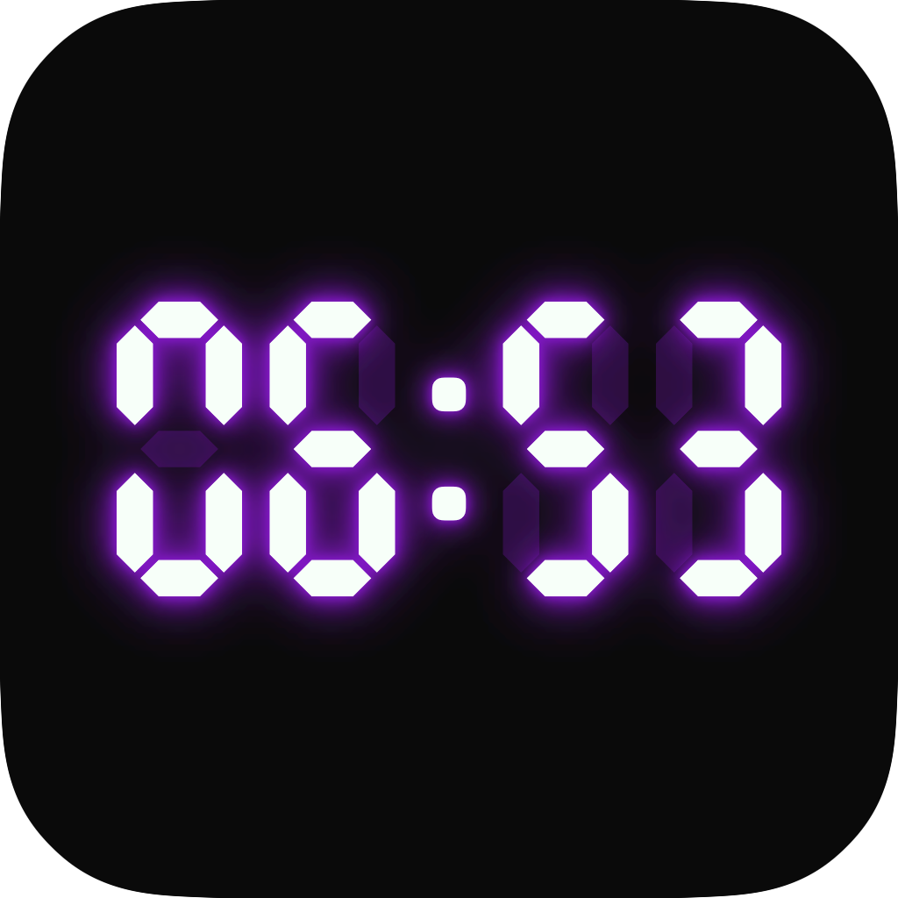

<p align="center">
  
</p>

<h1 align="center">Imperator WidgetClock</h1>

<p align="center">
  A seven-segment retro clock for the macOS desktop. One WidgetKit widget, plus
  a menu bar app that holds its settings.
</p>

The face is drawn from real segment outlines rather than a font, so the unlit
strokes stay visible at 25 percent the way the bars of an LCD clock never go
fully dark. The digits stand upright: most LED clock faces lean, this one does
not.

Five preset colours shared with the rest of the Imperator apps (Imperator Red,
Arcade Green, Neon Blue, Classic White, Electric Purple), a sixth swatch that
opens the system colour wheel, and an optional neon glow ported from the `.neon`
rule in imperator-deals.

Requires macOS 14 or later, Apple silicon. Built and tested on macOS 26 and 27:
older versions are expected to work but have not been verified.

Install at your own risk. The app is not notarized and carries no Apple
Developer signature, so macOS cannot vouch for it. It is provided as is, with no
warranty, under the MIT license.

## Install

Download the latest zip from
[Releases](https://github.com/goranimperator/imperator-widget-clock/releases),
unzip, and move `Imperator WidgetClock.app` to `/Applications`.

To build it yourself instead:

```bash
make install
```

That builds release, assembles `build/Imperator WidgetClock.app`, signs the
widget extension and then the app, copies it to `/Applications` and launches it.
The `Makefile` is the only build path.

Then place the widget: right-click the desktop, choose Edit Widgets, search for
Imperator WidgetClock, and drag the card out. There is one card, in the medium
size.

Two things worth knowing on first run:

- macOS renders desktop widgets in greyscale unless System Settings, Desktop &
  Dock, Widgets, Widget style is set to Full colour. The widget cannot override
  this. `WidgetRenderingMode` is handed to it, not chosen by it. `Dim widgets on
  desktop` in the same place greyscales the face too, and greyscale maps a
  colour to its luminance, so a saturated pick would come back almost black. The
  menu bar app reads that setting and the face renders white while it is on,
  then picks the colour back up when it is off.
- The build is signed with a self-signed certificate and is not notarized, so
  Gatekeeper blocks the first launch of a downloaded copy. Right-click the app
  and choose Open, or run:

```bash
xattr -dr com.apple.quarantine "/Applications/Imperator WidgetClock.app"
```

## Settings

Everything lives in the menu bar panel. The first three settings are the face,
and they go to the widget; the last two are the app's own:

| Setting | What it does |
|---|---|
| Colour | Five presets, plus a sixth swatch, marked with a pen, that opens the system colour wheel. Only the lit segments take the colour; the unlit ones stay neutral grey |
| Neon glow | Three stacked halos around the digits. The digits keep their colour |
| Hours | System, 24-hour or 12-hour. System follows the locale |
| Check for updates | Once a day the app asks GitHub whether a newer release is out. On by default. Check Now runs even with the switch off, because pressing it is an explicit request |
| Open at Login | Registers a login item through `SMAppService` |

Changing the colour, the glow or the hour format writes the shared settings file
and asks WidgetKit for a fresh timeline, so the widget catches up at once rather
than waiting out its current one. The writes are coalesced: dragging in the
colour wheel fires continuously, and one reload per tick would spend the daily
reload budget in a few seconds. The update switch and the login toggle never
touch that file, because the widget has no use for either.

The footer carries the login toggle on the left and About and Quit on the
right. About opens a small panel with the icon, the version the build actually
carries, the copyright and a link to goranimperator.com.

The panel follows the
[Imperator apps brandbook](https://github.com/goranimperator/imperator-apps-brandbook):
header, divider, content, divider, footer, 340pt wide, forced dark, brand red
instead of the system accent. The About panel follows section 10 of the same
book, and `--about-check` measures it rather than trusting it.

The panel itself is drawn rather than taken from `NSPopover`, because neither
frame an `NSPopover` draws on macOS 27 is the one the system puts under a menu
bar item: measured on the real windows, Control Centre's Wi-Fi panel rounds at
17.5 pt, while an `NSPopover` rounds at 26.25 or at 9.5 depending on the SDK
stamp in the binary. `MenuBarPanel` is the same 17.5 pt surface every Imperator
menu bar app draws, with no arrow and no animation, which is also what macOS
does.

## Updates

The app tells you when a newer release is out. It does not install it.

| What | How often | What it sends |
|---|---|---|
| Network | One request a day | A `GET` to `api.github.com/repos/goranimperator/imperator-widget-clock/releases/latest`, which is the app's only network traffic. It sends nothing but the app's name and version as the User-Agent GitHub requires. No telemetry, no analytics, nothing about you. Turn the daily check off in the panel's Updates section |
| Notifications | Once per version | A local notification, posted by the app itself. The permission is asked for the first time there is an update to report, never at first launch, and macOS may put that request in Notification Center rather than in front of you. Either way the Updates row in the panel says what is out, so nothing depends on the notification |

Version numbers are compared one component at a time, so 1.0.10 counts as newer
than 1.0.9 rather than older, which is what a string comparison makes of it.
`--update-check` runs that comparison against the six cases that have to come
out right.

A check only counts toward the day once GitHub has answered and the answer has
parsed, so a failure is retried within the hour rather than costing a day. The
hourly tick means a Mac that slept through the 24-hour mark checks soon after it
wakes.

Both the notification and the Download button open the release page and do
nothing else. Installing is the same as the first time: unzip, replace the copy
in `/Applications`, and clear the quarantine flag again, because a build
downloaded in a browser carries it and this app is not notarized.

```bash
xattr -dr com.apple.quarantine "/Applications/Imperator WidgetClock.app"
```

Sparkle would install the update in place without that prompt. It was turned
down: it is a third-party library in a family of apps that has none, and it
needs an EdDSA signing key per app to look after. Worth revisiting alongside
notarization, not before.

## Why the colon does not blink

A WidgetKit widget is a still frame that the system renders in advance and swaps
on a schedule. Its reload budget is measured in dozens of refreshes a day, and
one blink a second would need 86 400.

This was measured rather than assumed. With half-second timeline entries, ten
window captures taken 0.22 seconds apart came back byte-identical, because macOS
collapses anything finer than a minute. So the colon stays lit, the widget takes
one timeline entry per minute, and there is no pulse and no blink anywhere in
the code.

An earlier version drew a second clock straight onto the desktop, in a
borderless panel that did blink and pulse. It was removed: the clock is a widget
and nothing else.

## How it is built

There is no Xcode on the machine this was written on, only the Command Line
Tools, so there is no `.xcodeproj` and no `xcodebuild`. It is SwiftPM plus
Makefile bundle assembly, the same shape as the other Imperator apps. Four
targets:

- **`ClockCore`** is the whole face: segment geometry, the lit and unlit paths,
  the colour and glow rules, and the app/widget settings contract.
- **`ImperatorClock`** is the menu bar app: a status item, a settings panel and
  the daily update check, and nothing else. Two separate things keep it off the
  Dock and out of the app switcher, and it needs both: `LSUIElement` in
  `Info.plist`, because LaunchServices decides on the Dock tile before the
  process runs, and `setActivationPolicy(.accessory)` for the switcher and for
  the panel to behave as an accessory window. The menu bar icon is drawn rather
  than taken from SF Symbols, and its outline is `apple.terminal`'s frame, the
  symbol imperator-finder-terminal puts in its status item, so the two apps sit
  side by side as the same box with different contents. `UpdateChecker` lives
  in this target rather than in `ClockCore`, because `ClockCore` links into the
  widget extension and a sandboxed appex has no network entitlement and no
  business asking GitHub anything.
- **`ClockWidget`** is the widget extension. One widget, medium family only, one
  timeline entry per minute, 90 entries per request.
- **`ClockPreview`** is a headless renderer that produces the review PNGs and
  the pixel measurements behind the gates. It never ships. It does not draw the
  app icon: that is supplied artwork, and the renderer that used to generate it
  wrote over the file by default.

`make run` builds and launches from `build/` without installing. `make preview`
renders the face to `build/preview` and opens it. `make gates` runs every
acceptance check in `GATES.md`. `make clean` removes `build` and `dist`.

```bash
make run
```

```bash
make preview
```

```bash
make gates
```

```bash
make clean
```

Assembling an appex by hand has two traps, both of which make the widget
register with `pluginkit` and then render nothing, which looks exactly like a
widget that was never installed:

1. Every shipping macOS widget binary references `_NSExtensionMain`. A SwiftPM
   executable does not, so WidgetKit's `@main` falls into ExtensionFoundation,
   fails to recognise the extension type, and the process exits before it can
   answer `getAllDescriptors`. `Package.swift` links the widget with
   `-e _NSExtensionMain` for this reason.
2. `containermanagerd` rejects an App Group whose identifier is not prefixed
   with the signing team ID, and a self-signed build has no team. The rejection
   is fatal, so the extension died at sandbox init after 44 ms.

## Where the settings live

```
~/Library/Application Support/ImperatorClock/settings.json
```

Not in an App Group: the identifier has to be prefixed with the signing team ID
and a self-signed build has no team, so `containermanagerd` rejects it and the
rejection kills the extension at sandbox init.

Not in the widget extension's own container either, which is where it sat until
macOS 27 closed outside access to another app's container. After that upgrade
the app could neither read nor write it, so nothing the user changed reached the
widget and the face fell back to its defaults, white with no glow.

So the file sits where the unsandboxed app can always write, and the sandboxed
widget reaches it through a sandbox temporary exception in its entitlements.
That exception is a plain entitlement and is not checked against a team ID,
which is the difference that makes it work where the App Group did not.

That file is everything the widget draws from, and almost all of the app's
state. The rest is three `UserDefaults` keys that only the menu bar app reads:
`checkForUpdates`, `lastUpdateCheck` and `notifiedUpdateVersion`. They stay out
of the shared file on purpose, since the widget has no use for them and the
file is the app and widget contract rather than a general settings store.

The widget also writes a heartbeat next to it every time WidgetKit asks it for a
timeline. It is the only evidence from outside that the extension really ran and
what it read, and the acceptance check for the shared store reads it.

## Gates

`GATES.md` is the acceptance ledger: one observable outcome per gate, each with
the command that decides it. `make gates` runs every runnable one. Four need the
app installed, because they run the installed binary or ask `pluginkit` what is
registered, and the live widget check also needs the card placed on the desktop.

Registration is not accepted as proof of life. The extension was registered for
hours at one point while exiting after 44 ms, so the live check reads the
heartbeat and checks chronod's own verdict on the descriptor query:

```bash
node scripts/check-widget-live.mjs
```

When the widget looks dead, read the real logs. `log` is a zsh builtin that
shadows the tool, so call it by path:

```bash
/usr/bin/log show --last 5m --info --debug --predicate 'process == "chronod"' --style compact
```

`getAllDescriptors result.` means the extension answered. `error result` means
it died first.

## Release

Follow the `imperator-release` skill. Audit first, tag last, and never without
an explicit instruction.

```bash
make dist VERSION=x.y.z
make release VERSION=x.y.z NOTES="What this release changes."
```

`NOTES` is what the GitHub release page says. Leave it out and it falls back to
a description of the app, which only reads correctly on a first release. The
Gatekeeper instructions are appended either way.

`dist` is safe and touches nothing in git or on the remote. `release` bumps both
`Info.plist` files, commits, tags, pushes and publishes a GitHub release with
the zip attached. Both plists have to move together: the appex version is what
chronod caches a widget's descriptors against, so a version that never changes
means a reinstall keeps the old configuration.

Signing uses the self-signed `Imperator Dev` identity rather than ad-hoc. The
login item registration is keyed to the bundle's designated requirement, and
WidgetKit caches the extension by its signing identity, so an ad-hoc cdhash that
changes on every build would drop the widget out of the gallery after an update.

## Licence

MIT.
